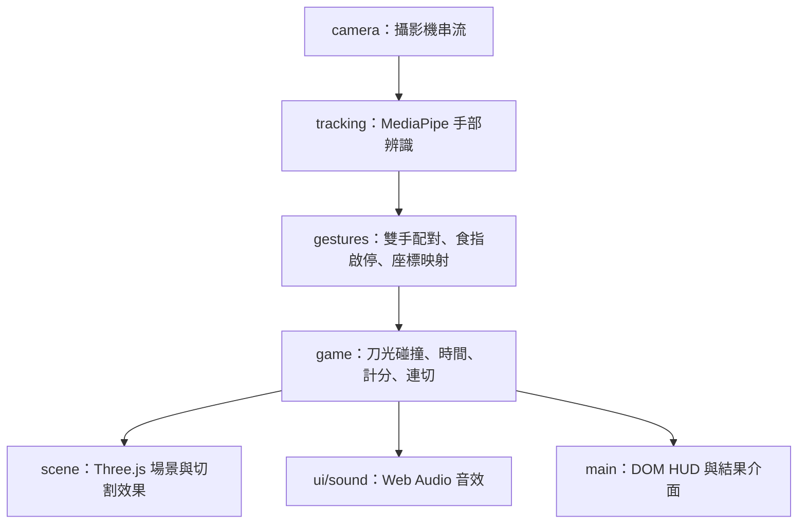

# 森之刃 · Forest Slice

以左右食指操作的 30 秒水果切割遊戲，結合 low-poly 森林場景、雙手刀光及連切加分。使用 Vite、TypeScript、Three.js 與 MediaPipe，攝影機影像只在裝置端處理，不上傳或儲存；無需登入。支援桌機與筆電遊玩；手機與平板會看到改用電腦的說明，但仍可瀏覽歷史排行榜。遊戲本身是純前端；選用的歷史排行榜使用 Supabase 保存成績，未設定時遊戲照常運作。

本專案使用 **OpenSpec 規格驅動開發**：先 `propose` 定義需求、規格與設計，再 `apply` 實作與驗證，最後 `archive` 同步正式規格並保留開發紀錄。

## 本機啟動

先準備 Node.js（符合專案 Vite 7 的需求：20.19+ 或 22.12+）與 pnpm，再執行：

```sh
pnpm install
pnpm assets
pnpm dev
```

筆電開啟 <http://localhost:5188>。`pnpm assets` 下載並校驗手部模型、複製 MediaPipe WASM，並產生追蹤 Worker；首次執行需要網路。模型與 WASM 在遊戲執行時由本站同源提供。

攝影機只能在受信任的安全來源（HTTPS 或 `localhost`）使用；從其他電腦以區網 HTTP IP 開啟時無法使用攝影機，需將 `pnpm build` 產生的 `dist/` 放到 HTTPS 靜態伺服器，或設定受信任的本地 TLS 代理。

| 指令 | 用途 |
| --- | --- |
| `pnpm dev` | 啟動開發伺服器，連接埠為 5188 |
| `pnpm assets` | 準備模型、WASM 與追蹤 Worker |
| `pnpm check` | TypeScript 型別檢查 |
| `pnpm test` | 執行 Vitest 單元測試 |
| `pnpm build` | 重建 Worker、檢查型別並輸出 `dist/` |
| `pnpm test:e2e` | 執行 Playwright 測試，需要本機安裝 Google Chrome |
| `pnpm test:db` | 以拋棄式 PostgreSQL 執行排行榜資料庫與 API 整合測試，需要 PostgreSQL 16 執行檔 |

修改 `src/tracking/worker.ts` 或其依賴後，開發期間可重新執行 `pnpm assets` 更新 Worker。正式建置會自動重建 Worker，但首次建置前仍需準備模型與 WASM。

## GitHub Pages 發布

部署成功後，公開遊戲網址為 <https://zooroy.github.io/ai_fruit_ninja/>，玩家不需登入 GitHub，以桌機或筆電允許攝影機權限即可遊玩。

首次發布需在儲存庫 **Settings → Pages → Build and deployment → Source** 選擇 **GitHub Actions**。GitHub Free 帳號需使用公開儲存庫。

[部署工作流程](.github/workflows/deploy.yml) 在推送至 `main` 時自動安裝鎖定依賴、準備模型與 WASM、執行單元測試、建置，再發布 `dist/`。也可以在 Actions 頁面選擇 **Deploy to GitHub Pages → Run workflow** 手動發布；建置或測試失敗不會部署新版本。

`vite.config.ts` 將正式建置的資源路徑設為 `/ai_fruit_ninja/`，本機開發仍使用 `/`。若更改儲存庫名稱或改用自訂網域，需同步調整 `base`。可在建置後預覽正式路徑：

```sh
pnpm exec vite preview --host 127.0.0.1
# 開啟 http://127.0.0.1:4173/ai_fruit_ninja/
```

## 歷史排行榜

首頁「啟動攝影機」下方的「歷史排行 TOP 10」不需攝影機即可瀏覽；每局結算時也會顯示同一份榜單、本局預估名次或與第十名的差距。

| 規則 | 說明 |
| --- | --- |
| 排序 | 分數高者在前；同分時較早被伺服器接受者在前，沒有並列名次 |
| 入榜資格 | 未滿十筆時任何分數（含 0 分）都可留名；滿十筆後必須**嚴格大於**第十名 |
| 差距 | 未達標時顯示追平所需分數，以及超越所需分數（多 5 分，即最小計分單位） |
| 留名 | 只有合資格且主動按「送出」才會保存；名字最多 20 字，留白為「不知名的勇者」，會公開顯示 |
| 每局獨立 | 不登入、不合併同名紀錄；同一局重試只會保存一筆 |
| 資格確認 | 送出時伺服器以最新榜單重新判斷，留名期間被超越會顯示「又有高手刷新紀錄了」 |

排行榜不是防作弊系統：伺服器只做格式、合理範圍與頻率檢查，無法證明分數來自真實遊玩。名字以純文字顯示；不當名字需由專案擁有者在 Supabase 後台刪除。

### 架構

```text
GitHub Pages（靜態網站）──fetch──▶ Supabase Edge Function: leaderboard ──service_role──▶ PostgreSQL RPC
       只知道公開網址                    CORS、驗證、節流、錯誤碼                     單一交易判斷資格並寫入
```

前端只需要公開網址 `VITE_LEADERBOARD_URL`，沒有任何金鑰。資料模型、權限、HTTP 契約、節流與函式秘密見 [supabase/README.md](supabase/README.md)。

### 本機設定

```sh
cp .env.example .env.local      # 填入 VITE_LEADERBOARD_URL；留空則排行榜顯示「森林英雄榜還沒開張」
pnpm test:db                    # 資料庫與 API 整合測試，不需要 Docker
```

`.env.local` 與 `supabase/.env*` 已被 Git 忽略。

### 部署順序

需要 [Supabase CLI](https://supabase.com/docs/guides/cli) 與專案擁有者權限；在本機終端機登入，不要把任何金鑰貼進文件、issue 或對話。

1. 在 Supabase 建立專案並連結：`supabase login`、`supabase link --project-ref <project-ref>`。
2. （建議）在 Dashboard 啟用 `pg_cron`，讓 migration 自動排程清除 24 小時前的節流紀錄。
3. 套用資料庫：`supabase db push`。
4. 設定函式秘密：
   ```sh
   supabase secrets set RATE_LIMIT_SECRET=$(openssl rand -hex 32)
   supabase secrets set ALLOWED_ORIGINS=https://zooroy.github.io
   supabase secrets set RATE_LIMIT_IP_HEADER=cf-connecting-ip
   ```
   `ALLOWED_ORIGINS` 只填來源（協定＋網域），不含 `/ai_fruit_ninja/` 路徑；測試專案可加上 `,http://localhost:5188` 供本機開發。`RATE_LIMIT_IP_HEADER` 的選擇依據見 [節流說明](supabase/README.md#節流)；不要改用 `x-forwarded-for`。
5. 部署函式：`supabase functions deploy leaderboard --use-api`（`supabase/config.toml` 已設定 `verify_jwt = false`；`--use-api` 由 Supabase 雲端打包，本機不需要 Docker）。
6. 以匿名 HTTP 驗證（應回 `200` 與 `{"entries":[...]}`）：
   ```sh
   curl -i -H 'Origin: https://zooroy.github.io' https://<project-ref>.supabase.co/functions/v1/leaderboard
   ```
7. 在 GitHub **Settings → Secrets and variables → Actions → Variables** 新增 repository variable `VITE_LEADERBOARD_URL` = `https://<project-ref>.supabase.co/functions/v1/leaderboard`。這是公開網址，放 Variables 而不是 Secrets；服務金鑰永遠不進 GitHub。
8. 推送到 `main` 或手動執行部署工作流程，建置時會注入上述網址。

### 免費方案暫停與恢復

Supabase 免費專案閒置一段時間會被暫停。暫停期間排行榜顯示「森林信使暫時迷路了」，遊戲、重玩與回首頁不受影響。到 Supabase Dashboard 選擇 **Restore project** 即可恢復，資料會保留；也請定期在 **Usage** 頁確認資料庫容量與函式呼叫量。

### 停用與回退

- 暫時停用：刪除 GitHub variable `VITE_LEADERBOARD_URL` 後重新部署，排行榜顯示「森林英雄榜還沒開張」；或回退到先前的前端版本。
- 停止 API：`supabase functions delete leaderboard`，前端會顯示讀取失敗而不影響遊戲。
- 資料表與既有成績保留，不提供破壞性 down migration；正式資料不可用 `supabase db reset` 清除。

## 遊玩方式

手機與平板（以觸控為主要操作方式的裝置）目前不支援遊玩，首頁會以說明卡取代「啟動攝影機」，但仍可開啟「歷史排行 TOP 10」瀏覽。判斷依據是瀏覽器回報的主要輸入方式（`(pointer: coarse) and (hover: none)`），因此有觸控螢幕但以觸控板或滑鼠操作的筆電、縮小的桌面視窗都可以正常遊玩。

1. 使用桌機或筆電，讓攝影機面向自己，保持手與臉前方有光。
2. 點「啟動攝影機」，授權後在鏡像預覽中確認手部入鏡。
3. 伸出任一食指，完成中央水果試切後開始挑戰。
4. 伸直食指出刀，收起食指收刀；左右手各自控制一道刀光，另一隻手可隨時加入。
5. 倒數 3、2、1 後開始 30 秒挑戰，結束後查看成績或重玩。

切換應用程式會暫停，回來後需主動繼續；手暫時離開畫面不會停表。設定可靜音或降低畫質，低畫質不改變遊戲規則。

## 使用 OpenSpec 開發

專案的 [OpenSpec 設定](openspec/config.yaml) 採用 `spec-driven` schema。開發前需安裝可使用的 OpenSpec CLI，並在支援本專案技能的 AI 助手中開啟專案。可在終端機執行 `openspec --version` 確認 CLI；`pnpm install` 不會安裝 OpenSpec。

```text
propose：需求 → proposal / specs / design / tasks
    ↓ 審閱提案，明確要求開始實作
apply：依 tasks 實作 → 測試 → 更新任務進度
    ↓ 確認完成狀態與規格差異
archive：同步正式 specs → 封存 change
```

下列 `$openspec-...` 範例是輸入 **Codex 對話框** 的技能指令，不是 shell 指令。也可以直接對助手說「openspec propose …」、「openspec apply …」或「openspec archive …」。

### 1. Propose：先定義要做什麼

例如要新增難度選擇，在 Codex 輸入：

```text
$openspec-propose 新增難度選擇，change 名稱使用 add-difficulty-selection。
提供簡單、普通、困難三種難度，說明生成速度與炸彈比例，維持現有計分規則。
```

助手會讀取既有規格，建立 `openspec/changes/add-difficulty-selection/`，依預設 schema 產生：

| 文件 | 內容 |
| --- | --- |
| `proposal.md` | 變更動機、範圍、受影響能力與影響 |
| `specs/<capability>/spec.md` | 此次新增、修改或移除的需求與驗收情境（delta specs） |
| `design.md` | 技術方案、模組調整、取捨與風險 |
| `tasks.md` | 可追蹤的實作及驗證任務 |

此階段只產生規劃文件。先審閱需求與驗收條件，確認後再另行要求 `apply`；若設計需要調整，先修正規劃文件，使提案、規格、設計與任務保持一致。

### 2. Apply：依規格實作並驗證

在 Codex 輸入：

```text
$openspec-apply-change add-difficulty-selection
```

助手會讀取變更文件，依 `tasks.md` 實作並更新完成勾選。開發時應保留攝影機、追蹤、純遊戲規則與場景的模組界線，並依變更範圍驗證：

```sh
pnpm check
pnpm test
pnpm build
pnpm test:e2e
```

若變更涉及手勢、攝影機或效能，還需依 [驗收紀錄](docs/verification.md) 進行真人實機驗證。模擬測試不能代替真實雙手操作、跨裝置相容性或散熱測試。實作中若發現需求或設計需要改變，先更新變更文件，再繼續實作。

可在終端機查看進度與檢查規格格式：

```sh
openspec list
openspec status --change add-difficulty-selection
openspec validate add-difficulty-selection --strict
```

OpenSpec 驗證用來檢查規格與變更文件，不代表遊戲功能測試已通過。

### 3. Archive：同步規格並封存

完成實作與驗證後，在 Codex 輸入：

```text
$openspec-archive-change add-difficulty-selection
```

助手會檢查規劃文件、任務完成狀態及 delta specs 與正式規格的差異，呈現需要同步的內容，依確認結果完成同步與封存：

- `openspec/specs/` 保存同步後的正式功能規格。
- `openspec/changes/archive/YYYY-MM-DD-add-difficulty-selection/` 保存此次提案、設計、delta specs 與任務紀錄。
- 若仍有未完成任務，應先完成或明確記錄接受現況的原因；封存不代表未執行的測試已通過。

Archive 是規格與變更紀錄的結案，不會自動執行 Git commit、push 或部署。下一次功能變更再建立新的 proposal。

既有流程範例：[add-gesture-fruit-ninja](openspec/changes/archive/2026-10-10-add-gesture-fruit-ninja/proposal.md)，可搭配其 [設計](openspec/changes/archive/2026-10-10-add-gesture-fruit-ninja/design.md) 與 [任務](openspec/changes/archive/2026-10-10-add-gesture-fruit-ninja/tasks.md) 閱讀。

## 技術架構

應用程式為純前端靜態網站，以一般 DOM 呈現 HUD 與控制介面，Three.js 繪製 3D 場景。`src/main.ts` 負責串接介面、攝影機、追蹤、遊戲狀態與渲染迴圈。



| 模組／檔案 | 責任 |
| --- | --- |
| `src/main.ts` | 應用流程、DOM 介面、生命週期與各模組整合 |
| `src/camera/camera.ts` | 取得及停止串流、面向玩家的鏡頭設定與錯誤處理 |
| `src/device.ts` | 判斷裝置是否支援遊玩（主要輸入為觸控且無懸停者不支援） |
| `src/tracking/model.ts` | 載入同源模型與 WASM，設定最多追蹤兩隻手 |
| `src/tracking/tracker.ts`、`worker.ts` | 排程推論、傳送影格、逾時處理及 Worker 初始化失敗時的主執行緒回退 |
| `src/tracking/gestures.ts` | 雙手身分配對、食指啟停、平滑、鏡像映射與中斷軌跡 |
| `src/game/engine.ts` | 獨立於攝影機與 WebGL 的時間、生成、碰撞、計分及連切規則 |
| `src/scene/forest.ts` | 森林背景、水果、炸彈、雙刀光、切半與粒子效果 |
| `src/ui/sound.ts` | 合成音效與靜音控制 |
| `src/leaderboard/` | 排行榜 API client、排名／資格／對白純函式、單局提交狀態與每局識別 |
| `src/ui/leaderboard.ts` | 首頁排行 dialog 與結算區內嵌榜單、留名表單 |
| `supabase/` | 排行榜 migration、Edge Function 與共用驗證規則，見 [supabase/README.md](supabase/README.md) |
| `src/style.css` | 桌面版面，含窄視窗與矮視窗 |

推論與渲染分開排程，同一時間最多一個推論在途；Worker 路徑限制最短間隔 40 ms，主執行緒回退為 80 ms，實際頻率仍取決於裝置效能。畫面以 3D 呈現，命中則使用共同的 2D 遊戲平面，以相鄰有效刀光點的線段判斷碰撞，避免快速揮動漏判。

應用流程為首頁 → 資源載入 → 試切 → 倒數 → 遊玩 → 結算。頁面隱藏或串流中斷時暫停，恢復後由玩家繼續；結算或離開時釋放攝影機與追蹤資源，重玩時重新取得。

## 功能規格

以下為正式規格摘要；完整需求與驗收情境以連結的 `spec.md` 為準。

### 手勢輸入（gesture-input）

完整規格：[gesture-input/spec.md](openspec/specs/gesture-input/spec.md)。

- 玩家主動啟動後才要求攝影機權限，提供鏡像預覽、放置引導及試切；模型與影像未就緒時不得開始計時。不支援的裝置不要求攝影機權限，也不載入模型。
- 支援單手或最多兩隻手，食指伸出啟用刀光、收起停用，左右刀光可同時命中不同目標。
- 刀光方向與鏡像預覽一致；追蹤遺失、身分配對不確定、收刀或版面改變時斷開軌跡，避免跨中斷誤切。
- 權限拒絕、找不到攝影機、不安全來源或模型載入失敗時顯示原因及重試方式。
- 影像不儲存、不上傳；結算或離開停止串流，重玩須重新等待資源就緒。

### 遊戲規則（arcade-session）

完整規格：[arcade-session/spec.md](openspec/specs/arcade-session/spec.md)。

| 項目 | 規則 |
| --- | --- |
| 時間 | 3 秒倒數後進行 30 秒挑戰；到期先結束，不接受終點或之後的命中 |
| 水果 | 每顆 +10 分，漏接無懲罰 |
| 炸彈 | 每顆 −50 分，最低 0 分；取消雙手尚未結算連切，遊戲繼續 |
| 連切 | 每道刀光從首顆命中起固定 300 ms 窗口，不延長、不合併雙手 |
| 連切獎勵 | 同一窗口至少 3 顆，額外 +5 × 顆數；3 顆總共 45 分 |
| 連切結算 | 窗口結束、收刀、追蹤中斷或遊戲到期時結算；炸彈或系統暫停取消尚未結算組 |
| 唯一命中 | 同一目標只處理一次，兩道刀光命中同一水果不重複計分 |
| 同時命中 | 同一時刻先處理水果基本分，再處理炸彈扣分與連切取消 |
| 暫停 | 頁面隱藏或串流中斷時凍結時間與物件、清除刀光和待結算連切；手出框不暫停 |
| 結果 | 顯示最終分數、水果數、炸彈數及最大連切，重玩清除上一局狀態 |

### 場景與呈現（forest-presentation）

完整規格：[forest-presentation/spec.md](openspec/specs/forest-presentation/spec.md)。

- low-poly 樹木、小屋、草地、暖光與立體水果，中央操作區保持清楚，炸彈以輪廓及標記區別。
- 水果命中後顯示兩半分離、果肉、果汁粒子及音效；連切與炸彈有各自的加扣分回饋。
- 左右刀光可辨識，提供靜音控制。
- 支援桌機與筆電（含縮小的窄、矮視窗），HUD 與控制項需可讀可操作，生成及判定範圍隨畫面調整。
- 手機與平板顯示改用電腦遊玩的說明，不提供開始遊戲的入口，仍可瀏覽排行榜。
- 低畫質降低背景、陰影與粒子成本，保留雙刀、目標及相同規則；必要功能無法啟動時顯示錯誤。

## 目錄結構

```text
src/
├── main.ts                 # 應用入口與介面整合
├── camera/                 # 攝影機生命週期
├── tracking/               # 模型、Worker 與手勢輸入
├── game/                   # 純遊戲規則
├── scene/                  # Three.js 場景
├── leaderboard/            # 排行榜資料、規則與提交狀態
├── ui/                     # 音效與排行榜介面
└── style.css               # 響應式樣式
supabase/
├── migrations/             # 排行榜資料表、RPC 與權限
└── functions/              # leaderboard Edge Function 與共用規則
public/                     # 同源模型、WASM 與產生的 Worker
scripts/                    # 資源準備、Worker 建置等工具
tests/                      # Vitest 單元測試、e2e/ 瀏覽器測試與 db/ 資料庫測試
openspec/
├── config.yaml             # spec-driven 設定
├── specs/                  # 正式功能規格
└── changes/                # 開發中的變更
    └── archive/            # 已完成變更的歷史紀錄
docs/                       # 驗收紀錄與介面截圖
```

## 驗證狀態

測試涵蓋遊戲規則、手勢合成輸入、攝影機生命週期、音效及瀏覽器流程。E2E 使用假攝影機與開發限定測試注入，正式建置不暴露測試 hooks。排行榜的瀏覽器測試使用模擬 API；資料庫交易、權限、並發與節流以 `pnpm test:db` 在真實 PostgreSQL 上驗證，但不能代替部署到 Supabase 後的實際串接驗證。

歷史測試結果、使用者試玩回饋與尚待真人驗證的項目見 [docs/verification.md](docs/verification.md)。手機與平板已不支援遊玩；桌機與筆電的跨裝置矩陣、連續三局效能與端到端延遲尚未有完整量測，不將瀏覽器模擬或任務勾選視為實機全部通過。

## 資源與授權

所有樹木、小屋、水果及效果幾何為本專案程式生成，沒有複製參考圖片；音效由 Web Audio 合成。

- Three.js：MIT。
- MediaPipe Tasks Vision / WASM：Apache-2.0，套件內附 LICENSE。
- Hand Landmarker 模型取自 Google 官方版本 1 公開模型 URL，來源及 SHA-256 記錄於 `public/models/manifest.json`，詳見 [官方模型說明](https://ai.google.dev/edge/mediapipe/solutions/vision/hand_landmarker)。

執行 `pnpm assets` 會準備鎖定套件版本的 WASM 與模型，遊戲執行時不向外部伺服器傳送影像。
