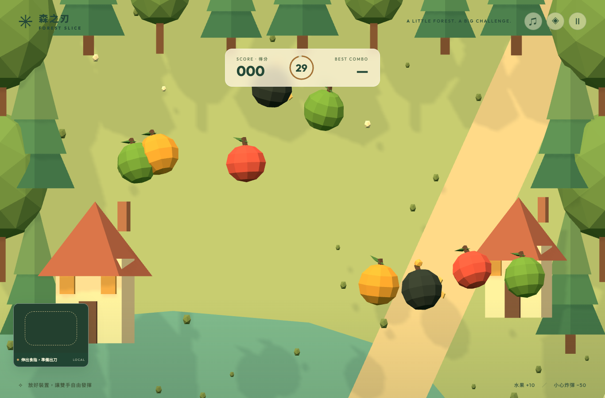
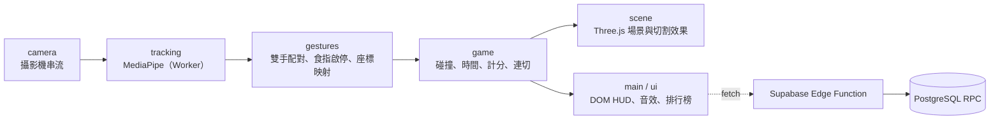

# 森之刃 · Forest Slice

用攝影機追蹤左右食指，在 low-poly 森林裡揮出雙刀切水果的 30 秒網頁遊戲。手部辨識完全在瀏覽器端執行，影像不上傳、不儲存，無需登入。

**🎮 線上遊玩：<https://zooroy.github.io/ai_fruit_ninja/>**（桌機／筆電，需允許攝影機）



**技術棧**：TypeScript · Vite · Three.js · MediaPipe Hand Landmarker · Web Worker · Web Audio · Supabase（Edge Function + PostgreSQL）· Vitest · Playwright · GitHub Actions

## 技術亮點

- **裝置端即時推論**：MediaPipe 在 Web Worker 執行，初始化失敗時自動回退主執行緒；推論與渲染分開排程，同時最多一個推論在途，避免低效能裝置積壓影格。
- **快速揮刀不漏判**：3D 呈現、2D 遊戲平面判定，以相鄰刀光點構成的線段做碰撞，而非單點檢測。
- **雙手獨立刀光**：左右手身分配對、各自的 300 ms 連切窗口；追蹤遺失或配對不確定時斷開軌跡，避免跨中斷誤切。
- **規則與渲染解耦**：`src/game/engine.ts` 不依賴攝影機與 WebGL，時間、生成、碰撞、計分與連切皆可純函式測試。
- **無金鑰的排行榜**：前端只知道一個公開網址；Edge Function 負責 CORS、驗證與 HMAC 節流，PostgreSQL RPC 在單一交易中判斷入榜資格並寫入，處理並發與冪等重試。排行榜為選用，未設定時遊戲照常運作。

## 架構



流程：首頁 → 資源載入 → 試切 → 倒數 → 30 秒遊玩 → 結算。頁面隱藏或串流中斷時暫停；結算或離開即釋放攝影機與追蹤資源。

**規則摘要**：水果 +10、炸彈 −50（最低 0 分）；同一道刀光 300 ms 內切中 3 顆以上，額外 +5 × 顆數。完整規則見 [arcade-session 規格](openspec/specs/arcade-session/spec.md)。

## 開發方式

採用 **OpenSpec 規格驅動開發**：每項功能先 `propose`（proposal / delta specs / design / tasks），審閱後 `apply` 實作與驗證，最後 `archive` 同步回[正式規格](openspec/specs/)。目前已完成 3 個變更：[手勢切水果](openspec/changes/archive/2026-10-10-add-gesture-fruit-ninja/proposal.md)、[歷史排行榜](openspec/changes/archive/2026-10-11-add-historical-leaderboard/proposal.md)、[停止支援行動裝置](openspec/changes/archive/2026-10-11-drop-mobile-support/proposal.md)。操作方式見 [OpenSpec 開發流程](docs/openspec-workflow.md)。

| 測試層級 | 指令 | 內容 |
| --- | --- | --- |
| 單元 | `pnpm test` | 遊戲規則、合成手勢輸入、攝影機生命週期、排行榜規則與 Edge handler |
| 瀏覽器 E2E | `pnpm test:e2e` | Playwright + 假攝影機跑完整流程；測試 hooks 不進正式建置 |
| 資料庫整合 | `pnpm test:db` | 拋棄式 PostgreSQL 16 驗證權限、並發搶鎖、冪等與節流 |

推送至 `main` 時，GitHub Actions 會先跑測試再建置、部署。真人實機驗證結果與尚未量測的項目（跨裝置矩陣、端到端延遲等）如實記錄在 [docs/verification.md](docs/verification.md)。

## 本機啟動

需要 Node.js 20.19+ 或 22.12+ 與 pnpm：

```sh
pnpm install
pnpm assets   # 下載並校驗手部模型、複製 WASM、產生追蹤 Worker（首次需網路）
pnpm dev      # http://localhost:5188
```

攝影機只能在 HTTPS 或 `localhost` 使用。排行榜需設定 `VITE_LEADERBOARD_URL`，部署與維運見 [docs/deploy.md](docs/deploy.md) 和 [supabase/README.md](supabase/README.md)。

## 資源與授權

場景、水果與特效幾何皆由程式生成，音效由 Web Audio 合成。Three.js（MIT）、MediaPipe Tasks Vision（Apache-2.0）；Hand Landmarker 模型取自 [Google 官方版本](https://ai.google.dev/edge/mediapipe/solutions/vision/hand_landmarker)，來源與 SHA-256 記錄於 `public/models/manifest.json`。
