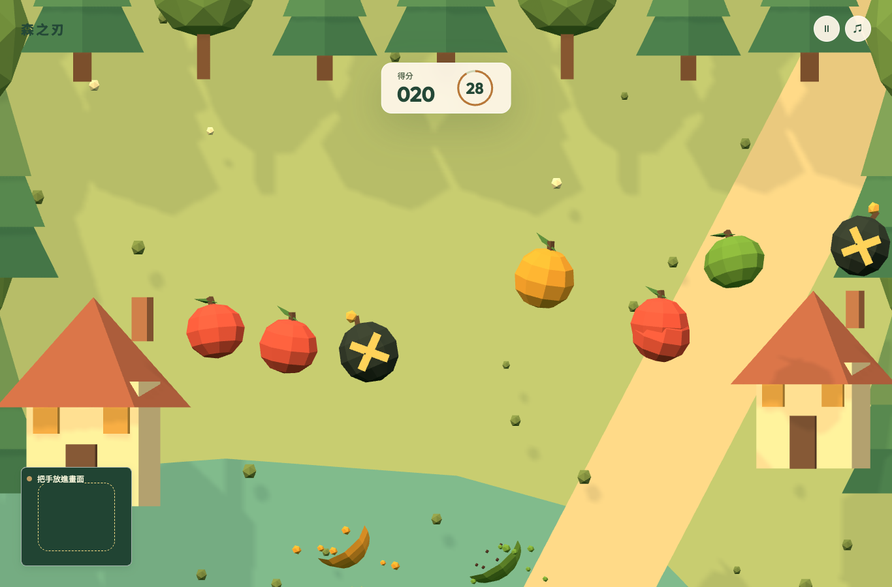

# 森之刃 · Forest Slice

用攝影機追蹤食指，在 low-poly 森林裡揮刀切水果的 30 秒網頁遊戲。手部辨識全在瀏覽器端執行，影像不上傳。

🔗 [Live Demo](https://zooroy.github.io/ai_fruit_ninja/)　｜　免登入，需桌機或筆電並允許攝影機



## Features
- 伸出食指就是刀，支援左右手同時揮刀，收起食指即收刀
- 30 秒計時；切中水果 +10，同一刀 300 ms 內連切 3 顆以上另有加分，切到炸彈 −50
- 開局前有試切教學；切換分頁或攝影機中斷時自動暫停
- 共享排行榜 TOP 10，結算時可留名

## Tech Stack
- **TypeScript（不使用 UI 框架）**：畫面只有幾個狀態疊在 canvas 上，以小型元件 factory 加設計 token 直接操作 DOM，配合 `requestAnimationFrame` 遊戲迴圈更新
- **Three.js**：場景、水果與切割特效全由程式生成幾何，不需要任何模型或貼圖檔
- **MediaPipe Hand Landmarker + Web Worker**：手部辨識在瀏覽器端完成，影像不離開裝置；推論放進 Worker，不占用渲染用的主執行緒
- **Supabase Edge Function + PostgreSQL**：前端只知道一個公開網址、不持有金鑰；入榜資格判斷與寫入在同一個 RPC 交易中完成，可承受並發送出與重試

## Verification
- **Static**：TypeScript strict、ESLint（typescript-eslint）（CI）
- **Test**：Vitest 154 個單元測試，涵蓋遊戲規則、合成手勢輸入與排行榜；Playwright 33 個 E2E，以 Chrome 假攝影機跑完整遊戲流程（CI）；真實 PostgreSQL 驗證權限、並發與冪等（本機）
- **Security**：`pnpm audit`（high 以上即失敗）、CodeQL（CI）
- **Acceptance Evidence**：E2E 截圖與 Playwright HTML 報告上傳為 CI artifact
- **Spec Validation**：以 OpenSpec 規格驅動開發，`openspec validate --strict` 檢查規格與變更（本機）；見[開發流程](docs/openspec-workflow.md)與[變更紀錄](openspec/changes/archive/)

## Getting Started
```bash
pnpm install
pnpm assets   # 下載並校驗手部模型（首次需網路）
pnpm dev      # http://localhost:5188
```

